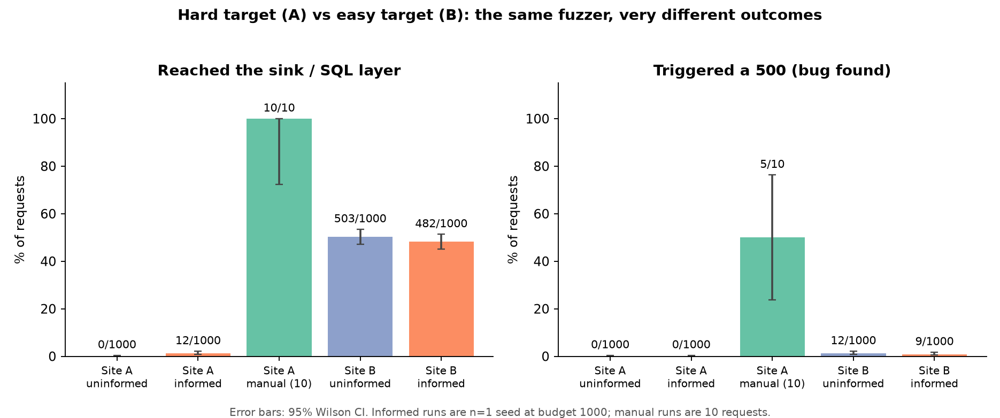

# AI-Assisted Web Fuzzing

EC 601 research project (Aarush Duvvuri). Does adding AI to a basic web fuzzer actually help? This repo builds one black-box HTTP fuzzer and compares a **mutation baseline**, a **learned prioritizer** (Sprint 2), and an **LLM-guided generator** (Sprint 3) on instrumented local targets, under fixed budgets and with server-side ground truth.

**Status: Sprint 1 (baseline and targets) complete. Sprint 2 (ML variant) is next.**

## Sprint 1 result in one picture

The same baseline fuzzer on the hard target (Site A) and the easy target (Site B). On Site A it never gets past the validation chain, even when told the secret prefix; a human reaches the sink 10/10.



Details, tables, and caveats: [docs/SPRINT1.md](docs/SPRINT1.md), Section 7.

## Quickstart

```bash
# 1. Install uv (https://docs.astral.sh/uv/)
#    macOS/Linux: curl -LsSf https://astral.sh/uv/install.sh | sh
#    Windows:     powershell -c "irm https://astral.sh/uv/install.ps1 | iex"

# 2. Clone and set up
git clone <repo-url> && cd <repo-dir>
uv sync                    # creates .venv from uv.lock
uv run pytest -q           # unit tests (64 passing)

# 3. Start the two targets (one terminal each)
uv run python targets/flask_app/app.py     # Site A, hard target, port 5000
uv run python targets/vuln_site/app.py     # Site B, easy target, port 5001

# 4. Run the baseline
uv run python -m fuzzer run --target flask_app --budget 200 --seed 42
uv run python -m fuzzer run --target flask_app --budget 1000 --seed 42 --wordlist data/wordlists/informed.txt

# 5. Cheapest test: 10 hand-written payloads against Site A
uv run python scripts/cheapest_test.py
```

Each run writes `results/run_<target>_<strategy>_s<seed>_b<budget>.json` (every request, its response, and the server-side ground truth joined by correlation ID).

### CLI options

| Option | Default | Meaning |
|---|---|---|
| `--target` | required | `flask_app` (Site A) or `vuln_site` (Site B) |
| `--strategy` | `baseline` | `baseline`; `ml` is Sprint 2 work in progress |
| `--budget` | 1000 | Exact number of requests |
| `--seed` | 42 | Random seed (same seed gives the same payload sequence) |
| `--wordlist` | `data/wordlists/mini.txt` | `informed.txt` adds the secret `SEARCH:` token |

### Regenerate tables and figures

```bash
uv run python scripts/summarize_results.py results            # prints tables to stdout
uv run --with matplotlib python scripts/make_figures.py results docs/figures
```

## The two targets

| | Site A (`flask_app`, :5000) | Site B (`vuln_site`, :5001) |
|---|---|---|
| Role | Hard: 7 validation checks before the sink | Easy: sanity check |
| Bug | `'` in the query after a valid `SEARCH:` prefix returns 500 | SQL injection via `q`; quote or null byte returns 500 |

Both targets log each request server-side with a correlation ID; the fuzzer only sees HTTP responses while running.

## Repository layout

```
fuzzer/        core loop, mutators, strategies, CLI (python -m fuzzer)
targets/       flask_app (Site A) and vuln_site (Site B), with server logs
scripts/       cheapest_test.py, verify_dvwa.sh, verify_llm_api.py, summarize_results.py, make_figures.py
data/wordlists mini.txt, informed.txt
tests/         pytest suite
results/       raw per-run JSON logs
docs/          SPRINT1.md, TEAM.md, AI-Review-Log.md, Faculty-List.md, figures/
```

## Documentation

| File | What it is |
|---|---|
| [docs/SPRINT1.md](docs/SPRINT1.md) | Plan, user stories, feasibility, tooling, evaluation, related work, Sprint 1 results |
| [docs/TEAM.md](docs/TEAM.md) | Team agreement (solo) and code workflow |
| [docs/AI-Review-Log.md](docs/AI-Review-Log.md) | Two-AI review of the plan |
| [docs/Faculty-List.md](docs/Faculty-List.md) | BU faculty and specific questions |

## Safety

The fuzzer refuses any target that is not `localhost` / `127.0.0.1`. Only test systems you own or are authorized to test. API keys live in `.env` (never committed); copy `.env.example` to start.

## Roadmap

- **Sprint 1 (done):** baseline fuzzer, two instrumented targets, oracle, harness, cheapest test.
- **Sprint 2:** classical ML prioritizer, compared against the baseline under identical budgets.
- **Sprint 3:** LLM-guided batched payload generation with cost logging.
- **Then:** full experiment matrix (30+ seeds, Mann-Whitney U and A12) and written report.
