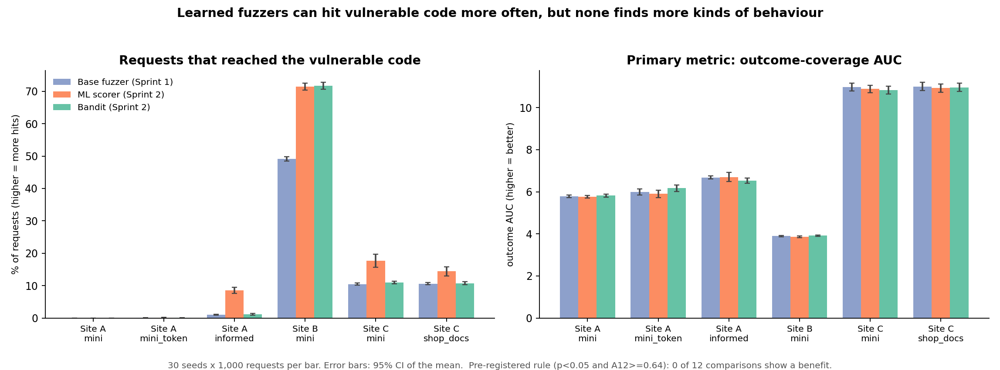
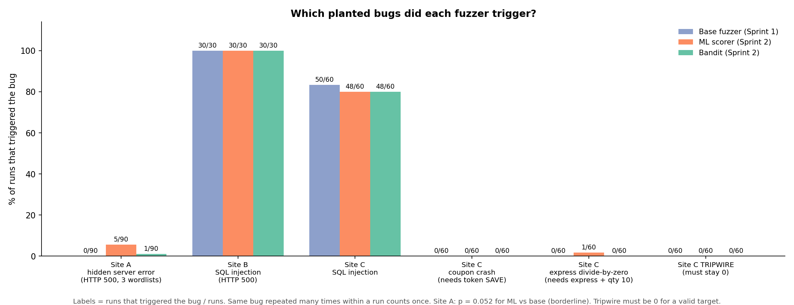

# Conclusions (running summary across sprints)

Plain-language results. Details and statistics: `docs/SPRINT1.md`, `docs/SPRINT2.md`, `docs/SITE_C.md`, `results/compare.txt`.
All numbers below come from `results/summary.csv` (30 runs per cell, 1,000 requests per run, seeds 42-71).

**The fuzzers being compared**
- **Sprint 1: base fuzzer** - random mutations plus a wordlist. No learning. (The baseline code is unchanged, so
  re-running it over 30 seeds is the same fuzzer as Sprint 1.)
- **Sprint 2: ML variants** - same mutations, but they *learn during the run* what works.
  `ml` = a gradient-boosting model picks the most promising payload. `bandit` = learns which mutation types pay off.
- **Sprint 3: LLM variant** - built and tested offline, **not run yet** (see the last section).

**The three targets**
- **Site A** - a hidden server error behind a chain of input checks (capped by the fuzzer's own mutations).
- **Site B** - a real SQL injection in a two-parameter search (found by the base fuzzer in about 65 requests).
- **Site C** - a checkout API with a deep validation chain, three planted bugs and one unreachable "tripwire" bug.
  Built to leave room for a better fuzzer to win, and frozen before any ML run (`docs/SITE_C.md`).

---

## The short answer

**The ML variants reach the vulnerable code more often, but they do not find more kinds of problems, and they do not
find them sooner.** This held on all three targets, including Site C, which was designed so a better fuzzer *could* win.

- **On the question we pre-registered** (does a variant find more kinds of server behaviour, earlier?): the answer is
  **"no evidence" in every one of the 12 comparisons (8 on Sites A and B, 4 on Site C).**
- **On how often they hit vulnerable code:** the ML model is clearly better (Site C: 9,632 requests reached the
  database insert vs 6,313 for the base fuzzer; Site A `informed`: 86 vs 10 per run; Site B: 714 vs 491 per run).
- **On finding things the base fuzzer cannot:** one small, borderline signal (Site A's hidden error: ML 5 of 30 runs vs
  0 of 30 for the base fuzzer, p = 0.052). The bugs on Site C that need a specific token (`SAVE`, or `express` with
  quantity 10) were **not** found by either ML variant (1 run of 60 for ML, 0 for the bandit, 0 for the base fuzzer).

---

  

(Figures are written to `docs/figures/` by `scripts/make_figures_sprint2.py`.)

---

## Site C: the harder target (30 runs x 2 wordlists = 60 runs per fuzzer)

| | Base fuzzer (Sprint 1) | ML model (Sprint 2) | Bandit (Sprint 2) |
|---|---|---|---|
| Tripwire bug triggered (must be 0) | 0 / 60 | 0 / 60 | 0 / 60 |
| Runs that triggered the SQL injection | 50 / 60 | 48 / 60 | 48 / 60 |
| Runs that triggered the coupon-parser crash (needs the token `SAVE`) | 0 / 60 | 0 / 60 | 0 / 60 |
| Runs that triggered the express zero-division (needs `express` + quantity 10) | 0 / 60 | 1 / 60 | 0 / 60 |
| Requests that reached the database (of 60,000) | 6,313 | **9,632** | 6,507 |
| Kinds of server behaviour found (avg per run, of 16 reachable) | 11.6 | 11.6 | 11.6 |
| Pre-registered test (does it find more kinds, earlier?) | - | **no evidence** | **no evidence** |

Plain reading: the ML model sends about 50% more requests that reach the database, but all three fuzzers find the
same 11-12 kinds of behaviour, and none of them gets past the two bugs that need a specific token. Before running,
we predicted the bandit would help a little; it did not (we were wrong).

## Site B: a real SQL injection (30 runs)

| | Base fuzzer | ML model | Bandit |
|---|---|---|---|
| Runs that found the SQL injection | 30 / 30 | 30 / 30 | 30 / 30 |
| Total requests that triggered it (HTTP 500) | 445 | **4,280** | 612 |
| Total requests that reached the database code | 14,726 | **21,425** | **21,508** |
| Kinds of server behaviour found (avg per run) | 4 | 4 | 4 |

Everyone finds this bug every time. The ML model just triggers the *same* bug about 10x as often.

## Site A: a hidden server error behind input checks (90 runs: 3 wordlists x 30)

| | Base fuzzer | ML model | Bandit |
|---|---|---|---|
| Runs that triggered the hidden server error (HTTP 500) | **0 / 90** | **5 / 90** | **1 / 90** |
| Total requests that reached the vulnerable code | 313 | **2,617** | 382 |
| Kinds of server behaviour found (avg per run) | 6.4 | 6.4 | 6.5 |

All five ML successes (and the bandit's one) were on the `informed` wordlist (the one that already contains the
`SEARCH:` token). With no hints, nobody got past the first checks.

---

## Sprint 1 -> Sprint 2 in five sentences

1. **Same bugs found.** Every bug the base fuzzer found, the ML variants also found.
2. **Far more hits on the bugs it already finds** (Site B: 445 -> 4,280 error-triggering requests; Site C: 6,313 -> 9,632
   requests reaching the database).
3. **A small, borderline gain on one hidden bug** (Site A: 0 of 30 -> 5 of 30 `informed` runs, p = 0.052).
4. **No gain in variety or speed**, on any of the three targets, under the pre-registered test.
5. **The bugs that need a specific token stay out of reach** for learners that only reshuffle the fuzzer's own tokens.

## What we can and cannot claim

- **Can claim:** the learned variants send more *valid, bug-reaching* requests, and the ML model occasionally gets past a
  check the base fuzzer never does.
- **Cannot claim:** that they find *more kinds* of bugs or find them *faster*. Three targets, including one built to
  reward a better fuzzer, show no such effect.
- **The earlier worry is now answered.** After Sites A and B we said the null might be a test problem (no room to win).
  Site C had room (the base fuzzer found only ~70% of what was reachable) and the result did not change, so the null is
  stronger, not weaker.
- **Open hypothesis, not a finding:** pooling all cells, the ML model may be slightly *slower* to a first interesting
  response (exploratory, p = 0.050, not pre-registered). Worth a deliberate test in Sprint 3.
- **Caveat on Site C:** it is synthetic and its token-gated bugs favour a fuzzer that can read error messages. That
  is a design choice, stated in `docs/SITE_C.md`.

---

## Sprint 3 (to fill in)

| | Base fuzzer | ML model | Bandit | LLM variant |
|---|---|---|---|---|
| Site A: runs that triggered the hidden error | 0 / 90 | 5 / 90 | 1 / 90 | _tbd_ |
| Site B: requests that triggered the SQL error | 445 | 4,280 | 612 | _tbd_ |
| Site C: runs that triggered `coupon_parser_crash` | 0 / 60 | 0 / 60 | 0 / 60 | _tbd_ |
| Site C: runs that triggered `express_zero_division` | 0 / 60 | 1 / 60 | 0 / 60 | _tbd_ |
| Site C tripwire (must stay 0) | 0 / 60 | 0 / 60 | 0 / 60 | _tbd_ |
| Cost per run (API tokens) | none | none | none | _tbd_ |

The Site C row pair is the real test of the LLM: it can read "example: SAVE10" and "'standard' or 'express'" in the
error messages, which no learner here can use. Rerun with:
`uv run python scripts/run_matrix.py --strategies baseline ml bandit llm --seeds $(seq 42 71)`
(the LLM needs `ANTHROPIC_API_KEY` and costs money; run a 100-request pilot first), then
`uv run python scripts/compare_strategies.py --csv results/summary.csv > results/compare.txt`.
