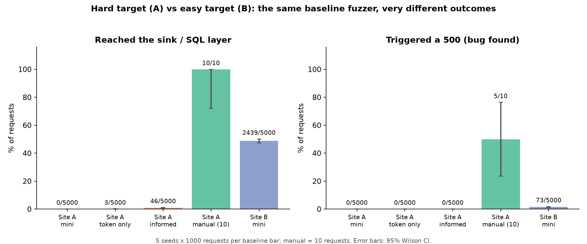
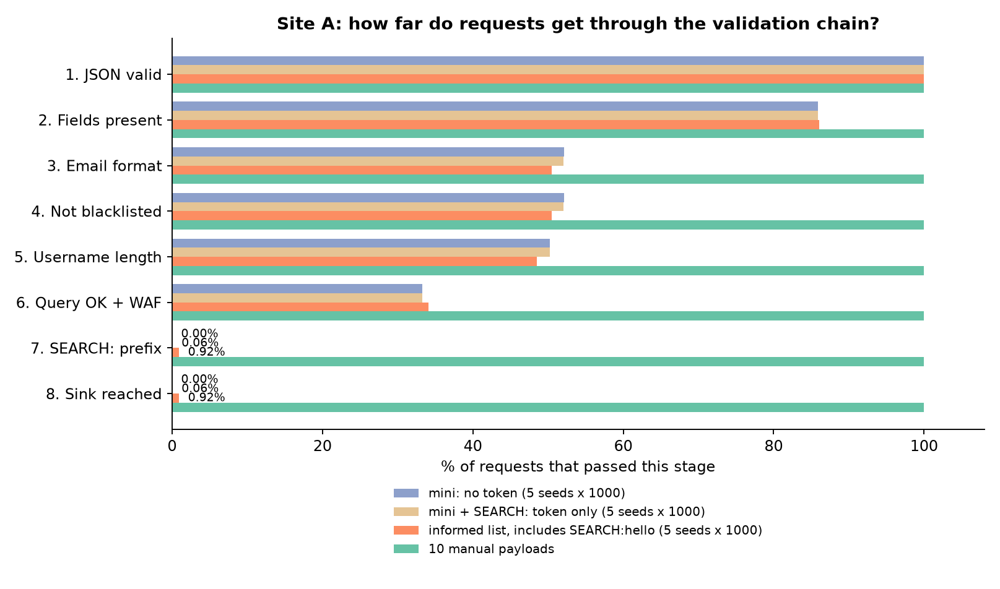

# AI-Assisted Web Fuzzing: Sprint 1 Plan and Results

Aarush Duvvuri · EC 601 · Solo project · Board: [Project Board](https://github.com/users/daarush/projects/2) · Related: [TEAM.md](TEAM.md), [AI-Review-Log.md](AI-Review-Log.md), [Faculty-List.md](Faculty-List.md)

**Sprint 1 at a glance.** Built a modular baseline fuzzer and two instrumented Flask targets (Site A: hard, Site B: easy), then ran the riskiest-assumption test. Result: across 5 seeds × 1,000 requests the plain baseline never reaches Site A's vulnerable code (0/5,000), no Site A baseline variant ever triggers its planted bug (0/15,000), a human reaches the code 10/10, and the same baseline finds real bugs on Site B (73/5,000). The premise holds, so Sprint 2 (ML) can start. One finding matters for Sprint 2: on these two targets the primary metric has little headroom (Section 7).

## 1. Mission

> For application-security engineers and researchers who want to know whether AI actually improves web fuzzing, this project builds a modular Python HTTP fuzzer and compares a mutation baseline against a learned prioritizer and an LLM-guided payload generator, measured by distinct server-side outcomes reached per fixed budget (requests, wall-clock, cost) and payload validation-pass rate on instrumented Flask targets with server-side ground truth.

This is a best guess, not final. The Sprint 1 test below (Section 7) is what it was checked against.

## 2. Target User

An application-security engineer or security researcher testing an internal or staging web application under a limited request budget, deciding whether an AI layer on a basic web fuzzer is worth the integration cost. They can run a Python script, read a JSON report, and interpret a comparison table. They do not need to train a model or write prompts: the tool and report should speak for themselves.

## 3. User Stories (top 5)

Each story is an issue on the board (EC601 #1 to #5). All five are Done on the board (the board is the source of truth).

| # | Story | Acceptance criteria | Status |
|---|---|---|---|
| 1 | As a researcher, I run the baseline fuzzer at a fixed request budget and get a structured JSON log of every request and response. | `uv run python -m fuzzer run --target flask_app --budget 1000 --seed 42` writes `results/run_<target>_<strategy>_<wordlist>_s<seed>_b<budget>.json`, with the wordlist also recorded in the file's `meta`. | Done |
| 2 | As a researcher, I inspect the target's server-side log to see which validation stage each payload reached. | Every request's correlation ID joins to a server log entry with stages passed, depth, and sink reachability. | Done |
| 3 | As a researcher, I use a CLI harness that enforces the budget, the random seed, and a target reset. | Same seed gives an identical payload sequence; the run stops at exactly the budget; non-localhost targets are refused. | Done |
| 4 | As a researcher, I run the "cheapest test" to show the target is hard for the baseline but solvable. | `scripts/cheapest_test.py` sends 10 hand-written payloads and reports sink-reach next to the baseline's measured rate (computed from `results/`, not hardcoded). | Done |
| 5 | As a researcher, I reproduce the environment on a new machine with one command. | `uv sync` installs everything from `uv.lock`; `uv run pytest -q` passes. | Done |

## 4. Feasibility (show, don't tell)

| Item | Proof in the repo | Status |
|---|---|---|
| Environment | `pyproject.toml`, `uv.lock`, `.env.example` | Verified on my Windows machine and in a clean Linux environment (`uv sync`, all tests pass, CLI reproduces the recorded runs exactly) |
| Site A (hard target) | `targets/flask_app/`: 7 validation checks, a sink, correlation-ID middleware, `/logs`, `/reset` | Running |
| Site B (easy target) | `targets/vuln_site/`: almost no validation, real SQL injection | Running |
| Fuzzer core | `fuzzer/`: strategy interface, exact-budget loop, JSON logger, localhost allowlist | 38 unit tests for the Sprint 1 code (`uv run pytest -q`) |
| DVWA (external sanity target) | `scripts/verify_dvwa.sh` | Smoke test passed |
| LLM API | `scripts/verify_llm_api.py` | **Blocked: API key pending**, script not yet run |

## 5. Tooling

| Tool | Why |
|---|---|
| Python 3.11 + `uv` | Project language; `uv.lock` gives a one-command reproducible environment |
| Flask | Both targets; easy to instrument with per-request correlation-ID middleware |
| `httpx` (sync) | Exact-budget request loop; deterministic; network errors are recorded, never raised |
| `pytest` | Unit tests for determinism, budget, oracle, and the localhost allowlist |
| JSON flat files | One log per run; no external database |
| Docker + DVWA | Standard external target, used only as a sanity check |
| `scikit-learn` (Sprint 2) | Fast, explainable prioritizer; no GPU |
| OpenAI API + Pydantic (Sprint 3) | Batched, schema-constrained payload generation. Cost and rate limit to be recorded once the key works |
| `matplotlib` (optional) | Result figures |

Everything runs on my laptop against localhost.

## 6. Demo Sentence

> At the end of two weeks I will show the baseline mutation fuzzer and the instrumented Flask target running end to end under a fixed request budget, and the "cheapest test" showing the target's validation is hard enough to justify AI in Sprint 2.

Status: shown (Section 7).

## 7. Riskiest Assumption, Its Test, and the Result

**Assumptions:** (1) a mutation baseline with a good wordlist does not already saturate Site A; (2) "interesting" can be defined precisely enough to measure; (3) an LLM can produce valid payloads fast enough for a fair comparison; (4) response features carry enough signal for a classifier to beat random; (5) Site A is hard enough that payload correctness is non-trivial.

**Riskiest: #1.** If the baseline already finds everything, there is nothing for AI to add.

**Cheapest test (run before any AI code):** run the baseline for 1,000 requests over 5 seeds on both targets, with three wordlists on Site A (plain `mini`; `mini_token`, which adds only the secret `SEARCH:` token; and the legacy `informed` list, which also contains a complete valid query), and send 10 hand-written payloads to Site A. The two sites differ on purpose: Site A tests intelligence, Site B tests that the fuzzer works at all.

**Terms.** *Sink*: the vulnerable code the fuzzer is trying to reach. *Depth*: how many of Site A's 8 validation stages a request passed (the server records it; the fuzzer never sees it). *Interesting*: the oracle defined in Section 8. *Token-only*: `mini` plus the single line `SEARCH:`. *Informed*: a legacy list that contains the complete valid query `SEARCH:hello`.

**Result: assumption #1 held.**

| Run | Site | Requests | Reached sink | Bug (500) | Runs with an interesting response |
|---|---|---|---|---|---|
| Baseline, `mini` | A | 5 × 1000 | **0 / 5000** | 0 | 0 of 5 |
| Baseline, `mini_token` (token only) | A | 5 × 1000 | 3 / 5000 (0.06%) | 0 | 2 of 5 (first at request 19 and 916) |
| Baseline, `informed` | A | 5 × 1000 | 46 / 5000 (0.9%) | 0 | 5 of 5 (median first at request 33) |
| 10 manual payloads | A | 10 | **10 / 10** | 5 / 10 | n/a |
| Baseline, `mini` | B | 5 × 1000 | 2439 / 5000 (48.8%) | 73 / 5000 (1.5%) | 5 of 5 (median first at request 65) |

Where requests die on Site A (the baseline stalls at the `SEARCH:` prefix check, stage 7):

*More charts: [per-seed view](figures/fig3_per_seed.png) and [outcome coverage](figures/fig4_outcome_coverage.png).*

- **The premise survives.** The plain baseline never reached Site A's sink (0/5,000), and no Site A run ever triggered the bug (0/15,000). A human reaches the sink 10/10. Site B shows the fuzzer and oracle work: every seed found a real bug (1.5% of requests).
- **Knowing the token is not enough; a complete valid query is.** `mini_token` reached the sink 3 times in 5,000 requests, while `informed` reached it 46 times, and 27 of those 46 were the single wordlist entry `SEARCH:hello`. So the informed list's advantage comes from containing a ready-made valid query, not from knowing the token. Even then, none of the 49 sink-reaching requests produced the 500, so reaching the sink and triggering the bug are separate hurdles.
- **The primary metric has little headroom on these targets.** Plain mutation reaches 6 distinct server-side outcomes on Site A in every seed (7 with the informed list) and all 4 on Site B in every seed, leaving room for at most one or two more. This is why a third target is planned before any AI variant runs (Section 8).
- **Caveats.** These are baseline-only results; no AI variant has been run. Runs are deterministic (the same seed reproduced identical runs on Windows and Linux), so seeds measure the mutator's sampling variability only. `informed.txt` is a legacy 8-entry list rather than `mini` plus the token, which is why `mini_token` was added as the clean control. Site A's 0/5,000 for `mini` is expected by design, and Site B's 73 errors are only 2 distinct error classes (45 quote/syntax, 28 null-byte). The original 200-request runs agree and remain in `results/`.

**Pivot line.** I pivot if, against Site A with a standard wordlist, neither the ML nor the LLM variant reaches an error class or validation stage the baseline cannot. The project then becomes "AI triages and explains findings for a human analyst" instead of "AI finds more." The pivot metric is defined now: precision@10 of the "interesting" findings when ranked by the AI's score, compared with ranking by arrival order, scored against server-side ground truth.

## 8. Evaluation with a Baseline

- **Oracle ("interesting").** HTTP 5xx, or an error signature in the body, or server-confirmed new maximum validation depth. This is anomaly detection for triage, not confirmed exploitation.
- **Primary metric (decided in advance).** *Outcome coverage*: the number of distinct server-side outcomes reached (ground truth from the server log, such as `bad_email_format`, `waf_blocked`, `sink_executed`), as the area under the discovery curve over a fixed 1,000-request budget. Requests-to-first-interesting is secondary because it is one event per run and saturates: each Site A run produced at most 1 interesting event, and plain mutation already reaches 6 distinct outcomes in all 5 seeds (7 with the informed list).
- **Decision rule.** A variant "helps" only if it beats the baseline on outcome coverage at equal request budget (Mann-Whitney U p < 0.05 and A12 >= 0.64). Wall-clock and dollars are reported but cannot change the headline; if a variant wins on requests and loses on time or cost, the report says so explicitly.
- **Secondary metrics.** Requests to first interesting response; share of payloads that pass all validation stages and reach application logic; wall-clock; LLM tokens and dollars.
- **What each variant may see.** Baseline: nothing. ML: client-visible response features only (status, body length, error text, latency). LLM: endpoint context (field names, types, example valid values) plus the client-visible results of its earlier batches. No variant sees the server log, depth, or outcome label; those only score runs afterwards.
- **Controls (added after the AI review).** (1) A baseline given the same endpoint context as the LLM (a wordlist built from field names and example values), so "AI" is not confused with "access to context". (2) An LLM with no feedback loop (one batch, no updates), to separate better priors from learning.
- **Statistics.** At least 30 seeded runs per variant per target (10 minimum if compute-bound); Mann-Whitney U for significance and Vargha-Delaney A12 for effect size, following the FuzzBench method [3].
- **Baseline.** My own mutation fuzzer (dictionary + random mutation), identical to the AI variants in everything except the intelligence layer. The baseline's cost is about 14 ms per request and no tokens.
- **Sanity reference.** One `ffuf` run against the custom targets (not DVWA), as a different tool class rather than a competitor. The DVWA smoke test stays as an environment check only.
- **LLM design.** Batched (about 50 to 100 payloads per call; 30 runs x 1,000 requests is about 300 calls per target), schema-constrained, temperature 0. Model version, full prompts, and raw responses are logged. LLM runs are treated as stochastic (a fixed seed does not make them reproducible), so they are compared as distributions with bootstrap confidence intervals. Tokens, latency, and dollars are logged as cost metrics.
- **Frozen targets.** Site A is frozen (a version hash will be logged in every run) so it cannot be tuned after seeing results. Both sites are stateless by design (no sessions, auth, or CSRF); stateful workflows are out of scope. Before any AI variant runs, a third target with several endpoints and a documented validator taxonomy (regex, type, length, cross-field, business rule) is added, because Site A alone has too few distinguishable outcomes.
- **Fixes before Sprint 2 comparisons.** (a) Rerun every wordlist at the same budget over 5 seeds with `scripts/run_matrix.py` (done: results in `results/matrix/`, summarized by `scripts/summarize_results.py results/matrix`; this is the clean baseline floor for Sprint 2); (b) the wordlist is now recorded in each run's metadata and filename (done); (c) findings are reported by error class in `scripts/summarize_results.py` (done); (d) runs with no interesting response are reported as censored rather than dropped (done in the summarizer); (e) the server's outcome label is stored per request and counted as `distinct_outcomes` (done).

## 9. Related Work

| # | Paper | What it does | What it leaves open for this project |
|---|---|---|---|
| 1 | Manès et al., [Art, Science, and Engineering of Fuzzing](https://ieeexplore.ieee.org/document/8863940), TSE 2021 | Unified fuzzer model and taxonomy | Little on black-box HTTP feedback loops |
| 2 | Gan et al., [CollAFL](https://www.computer.org/csdl/proceedings-article/sp/2018/435301a679/12OmNBKEyoL), S&P 2018 | Collision-free coverage feedback | Needs program CFG; a remote service gives none |
| 3 | Fioraldi et al., [Dissecting AFL](https://dl.acm.org/doi/10.1145/3580596), TOSEM 2023 | Ablates AFL design choices on FuzzBench | Native-code targets only; motivates ablating each "intelligence" choice |
| 4 | Fioraldi et al., [AFL++](https://www.usenix.org/conference/woot20/presentation/fioraldi), WOOT 2020 | Modular platform with a plugin API | Architectural model for my strategy interface; not black-box HTTP |
| 5 | Böhme et al., [Greybox Fuzzing as a Markov Chain](https://ieeexplore.ieee.org/document/8233151), TSE 2019 | Formal model of coverage-guided scheduling | Assumes coverage; web needs response-based signals |
| 6 | Ji et al., [ChatAFL](https://www.ndss-symposium.org/ndss-paper/large-language-model-guided-protocol-fuzzing/), NDSS 2024 | LLM-in-the-loop protocol fuzzing | Network protocols, not web forms; the loop is relevant to my LLM variant |
| 7 | Xia et al., [Fuzz4All](https://arxiv.org/abs/2308.04748), ICSE 2024 | LLM input generation with prompt updating | No HTTP state, schema, or response feedback |
| 8 | Hou et al., [LLMs for Cybersecurity: A Survey](https://arxiv.org/abs/2402.16968), 2024 | Landscape of LLMs in vulnerability work | A survey, not a controlled web-fuzzer benchmark |
| 9 | Godefroid et al., [Grammar-based whitebox fuzzing](https://dl.acm.org/doi/10.1145/1375581.1375607), PLDI 2008 | Grammars get inputs past early parsers | Needs whitebox access and a hand-written grammar |
| 10 | [OSS-Fuzz](https://github.com/google/oss-fuzz) / [FuzzBench](https://fuzzbench.com/) | Large-scale fuzzing and benchmarking infrastructure | Good evaluation model (fixed budgets, statistics); not black-box HTTP |

**The gap.** Nobody has run a controlled, ablated comparison of mutation vs. ML vs. LLM strategies for web fuzzing with server-side ground truth. Papers 1 to 5 supply the loop, 6 and 7 the generation idea, and this project joins them in the web domain.

## 10. Three Lines on Harm

1. Pointed at a system without authorization, the fuzzer produces attack-like traffic that can trigger incident response or cause denial of service, so it refuses any non-localhost target.
2. LLM-generated SQLi/XSS payloads could be copied into real attacks if reports are shared carelessly, so payloads are logged but reports avoid ready-to-use exploit strings.
3. A negative "AI doesn't help" result drawn from a weak target or metric could be misused to dismiss AI-assisted testing, so every finding states its scope (two local targets, one author).
