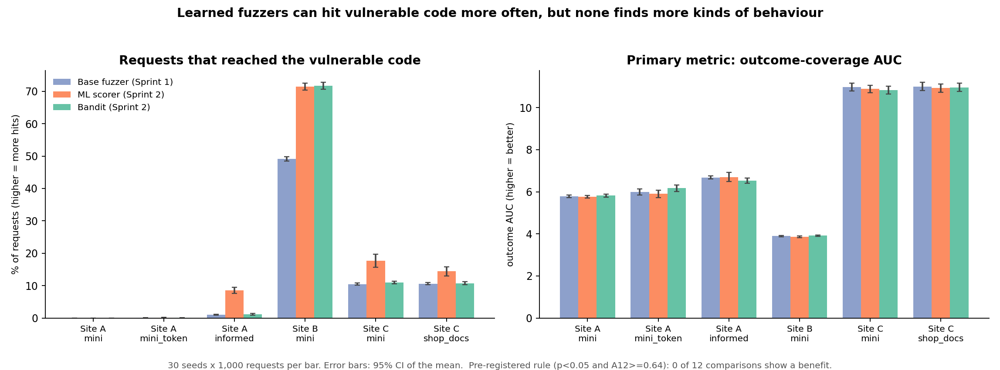
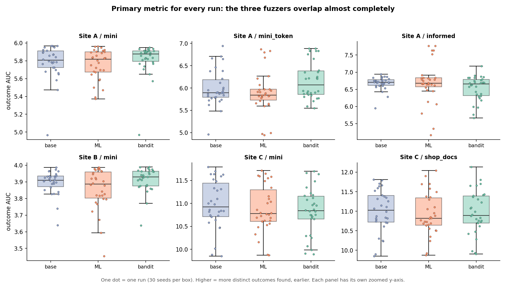
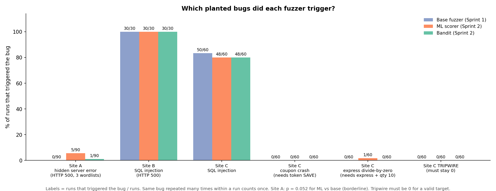

# Sprint 2: Online-learning variants vs the baseline, on three targets

**Goal.** Build ML-assisted fuzzing strategies *from scratch* (no pretrained model) and compare them against the
Sprint 1 baseline under the pre-registered protocol, on Sites A, B and C.
**Out of scope for this sprint:** the LLM variant (code exists and is tested offline; it has not been run; Sprint 3).

## 1. What was built

| Variant | Learns | How | Code |
|---|---|---|---|
| `ml` | which *payloads* look promising | Each turn: 20 candidate mutations (the baseline mutator), a gradient-boosting regressor scores them, the best is sent. Trained online on `(payload features -> response rarity)`. Per-field, validity-aware features. 10% random exploration. | `fuzzer/ml_strategy.py`, `fuzzer/features.py` |
| `bandit` | which *mutations* pay off | Thompson sampling over (field, operator) arms with a Beta posterior each. Same mutation primitives and 1-3 stacking as the baseline. No features, no sklearn. | `fuzzer/bandit_strategy.py` |

Both start with no knowledge and learn only from the target's responses during the run. Both use **client-visible
data only** (status code, response body, payload); server-side ground truth is never an input (asserted by tests).
Reward = response *rarity* (ML: `1/count` of a response signature; bandit: binary "new or rarer than the average
kind"). The bandit's reward differs because `1/count` made it indistinguishable from the baseline in testing.

Fairness properties, all covered by tests: until its first fit the ML variant sends exactly the same payloads as
the baseline for the same seed; every variant spends the same request budget; hyperparameters are saved in each
run's `meta.params`.

**Targets.** Site A (`flask_app`): hidden server error behind an input-check chain. Site B (`vuln_site`): a real SQL
injection in a two-parameter search. Site C (`shop`): a checkout API with a deep, dependent validation chain, three
planted bugs and one unreachable tripwire bug; built to leave headroom, calibrated on the baseline only and frozen
before any ML/bandit run (`docs/SITE_C.md`).

## 2. Evaluation protocol (as pre-registered in SPRINT1.md, section 8, and docs/SITE_C.md)

- Cells: Site A x {`mini`, `mini_token`, `informed`}, Site B x {`mini`}, Site C x {`mini`, `shop_docs`} = 6 cells.
- 1000 requests per run, **30 seeds (42-71)**, 3 strategies = **540 runs**. Same seeds across strategies.
- **Primary metric: outcome-coverage AUC** (mean number of distinct server outcomes seen after each request).
- Rule: a variant "helps" only if Mann-Whitney p < 0.05 **and** Vargha-Delaney A12 >= 0.64.
- Secondary / descriptive: final distinct outcomes, requests-to-first-interesting (censored at budget + 1),
  `sink_hits` (requests that reached the vulnerable code; a payload-correctness proxy), interesting responses,
  and which planted bugs were triggered in a run.
- Reproduce: `uv run python scripts/run_matrix.py --strategies baseline ml bandit --seeds $(seq 42 71)` (Sites A/B;
  add `--targets shop` for Site C, with each target's server running), then
  `uv run python scripts/compare_strategies.py --csv results/summary.csv > results/compare.txt`.

## 3. Results (means over 30 seeds; full table in `results/compare.txt`, per-run data in `results/summary.csv`)

**Primary metric: no variant helps in any of the 12 comparisons.**

| Cell | outcome AUC: baseline | ML | bandit | Verdict (both) |
|---|---|---|---|---|
| Site A / mini | 5.78 | 5.76 | 5.82 | no evidence |
| Site A / mini_token | 6.00 | 5.90 | 6.17 | no evidence |
| Site A / informed | 6.68 | 6.70 | 6.53 | no evidence |
| Site B / mini | 3.90 | 3.86 | 3.91 | no evidence |
| Site C / mini | 10.98 | 10.88 | 10.83 | no evidence |
| Site C / shop_docs | 11.01 | 10.93 | 10.96 | no evidence |

**Secondary metrics.**

| Cell / metric | baseline | ML | bandit |
|---|---|---|---|
| Site A informed: requests reaching the sink (of 1000) | 10.0 | **86.1** (p<0.001) | 11.9 (n.s.) |
| Site B: requests reaching the sink (of 1000) | 490.9 | **714.2** (p<0.001) | **716.9** (p<0.001) |
| Site C / mini: requests reaching the DB insert (of 1000) | 104.5 | **177.0** (p<0.001) | 109.5 (n.s.) |
| Site C / shop_docs: requests reaching the DB insert | 106.0 | **144.1** (p<0.001) | 107.4 (n.s.) |
| Site B: interesting responses per run | 14.8 | **142.7** (p<0.001) | 20.4 (p=0.045) |
| Site C / mini: interesting responses per run | 3.1 | **19.6** (p<0.001) | 2.4 (n.s.) |
| Site A informed: runs that triggered the planted 500 | 0/30 | 5/30 (Fisher p=0.052) | 1/30 (n.s.) |
| Site C: runs (of 60) that triggered `coupon_parser_crash` | 0 | 0 | 0 |
| Site C: runs (of 60) that triggered `express_zero_division` | 0 | 1 | 0 |
| Site C: tripwire `premium_crash` (must be 0) | 0 | 0 | 0 |

### Figures
Generate with `uv run --with matplotlib --with pandas python scripts/make_figures_sprint2.py` (writes `docs/figures/fig5-fig8`).

## 4. Interpretation

1. **Both learned models make a larger share of requests reach application logic, and the ML model does so most**
   (Site B about 49% -> 71%; Site C about 10.5% -> 16.1% for ML; Site A `informed` 1% -> 8.6%). Replicated across
   two independent seed sets on Sites A and B.
2. **They do not discover more kinds of behaviour or discover it sooner**, on any of the three targets. On Site C,
   which was designed so the baseline reached only ~70% of the reachable outcomes, the result did not change: the
   null on the primary metric is not just a headroom artifact.
3. **The bugs that need a specific token stayed out of reach** (`coupon_parser_crash`: 0/60 for every strategy;
   `express_zero_division`: 1/60 for ML). Learners that reshuffle the mutator's own tokens cannot invent them.
4. **"More interesting responses" is mostly repetition** of a known error (distinct outcomes are identical), so it is
   a confirmation yield, not more findings.
5. Pivot rule (SPRINT1.md section 7): ML triggered Site A's planted bug in 5/30 `informed` runs vs 0/30 for the
   baseline, borderline (p=0.052). Not triggered on `mini` / `mini_token` for any variant.
6. **Pre-registered prediction scorecard for Site C** (`docs/SITE_C.md`): tripwire, baseline and ML predictions were
   confirmed; the bandit prediction (a modest gain) was wrong.
7. **Exploratory, post-hoc, not pre-registered (hypothesis only):** pooling the cells, ML's outcome AUC is at or below
   the baseline's everywhere (pooled p=0.077) and its first interesting response comes later in 4 of 5 cells
   (pooled p=0.050). Four uncorrected looks: a hypothesis for Sprint 3, not a finding.

## 5. Deviations and limitations

- **Third target built late, but frozen before any ML/bandit run on it** (section 8 wanted it before any AI variant ran).
  Sites A and B were evaluated first; Site C was calibrated on the baseline only, frozen (hash-checked by a test),
  then run with written predictions.
- **Site C is synthetic**, designed by the people building the strategies; its token-gated bugs favour a strategy that
  reads error messages. Calibrating on the baseline alone limits, but does not remove, this bias.
- **Little headroom on Sites A and B:** Site A `mini` is capped by the mutator; on Site B the baseline reaches its first
  interesting response by about request 64. Site C was added to address this.
- No multiple-comparison correction: 60 tests appear in the full table, so isolated p~0.04 results (e.g. bandit on
  `mini_token`) should be treated as noise; an earlier seed set did not replicate them.
- Windows ran out of temporary network ports partway through the Site C bandit runs (WinError 10048). No partial run was
  saved; `run_matrix.py` now retries a failed run from scratch and has `--resume`. The 146 finished runs were kept.
- The LLM variant is **not** part of this sprint's results. The client uses the Anthropic API (SPRINT1.md lists OpenAI;
  update one or the other).
- AI-assisted development is recorded in `docs/AI-Review-Log.md`.

## 6. Next (Sprint 3)

1. Run the LLM variant: a 100-request pilot first (check fallbacks are 0), then the full set on all three sites,
   reporting token/latency cost beside any gain. Compare against the predictions in `docs/SITE_C.md`.
2. Test the post-hoc hypothesis that ML trades exploration for yield (e.g. vary its exploration rate).
3. Optional: ML feature ablation and a bandit/ML hybrid.
